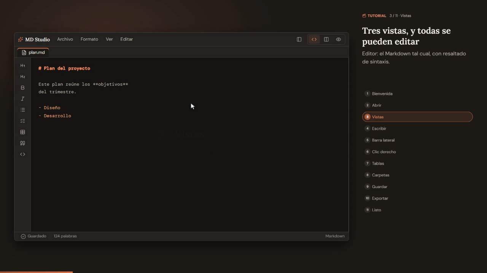
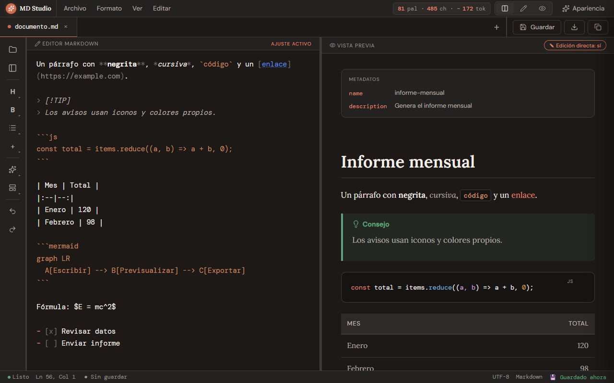
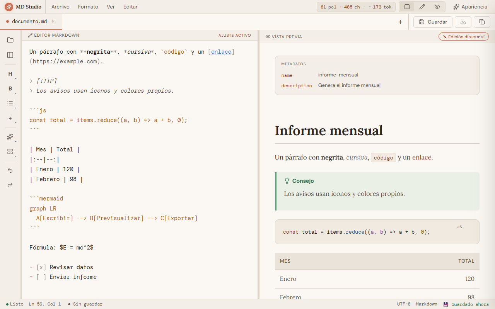
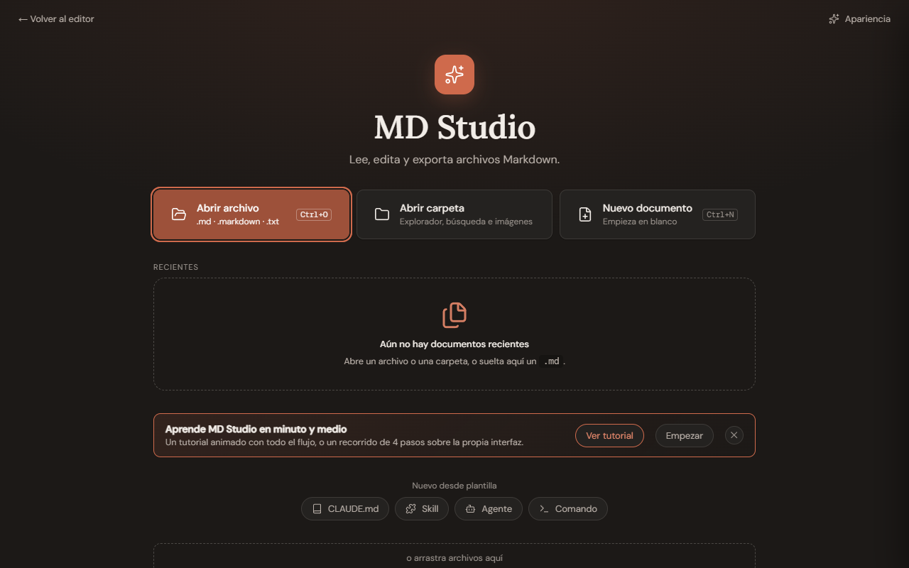
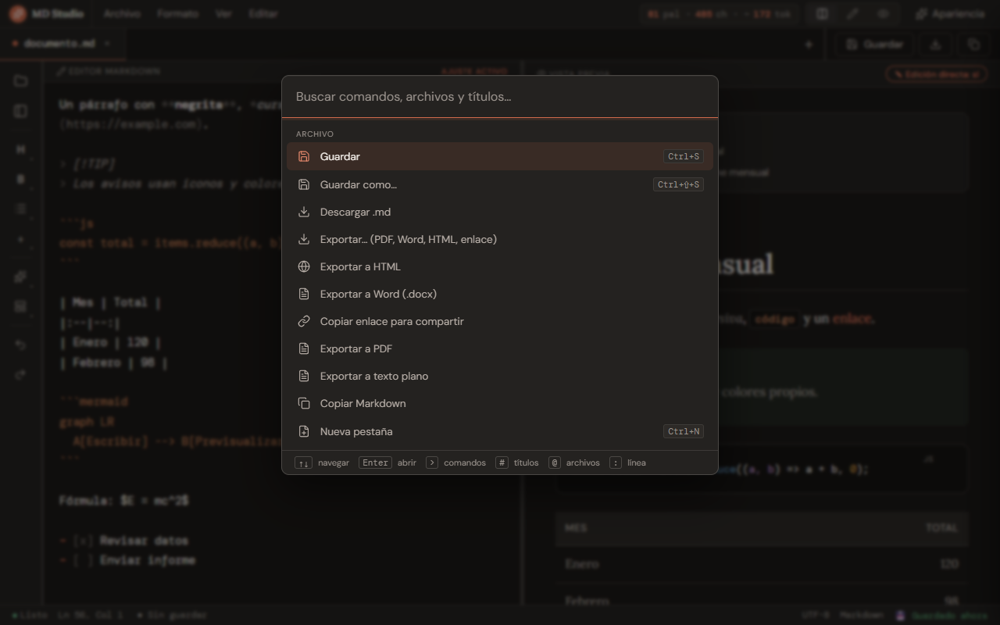
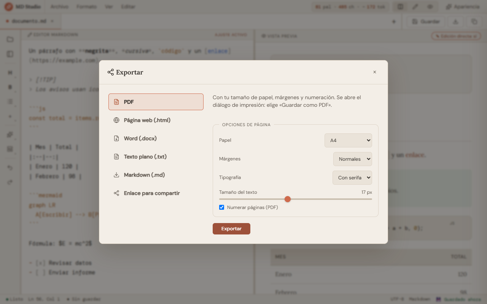
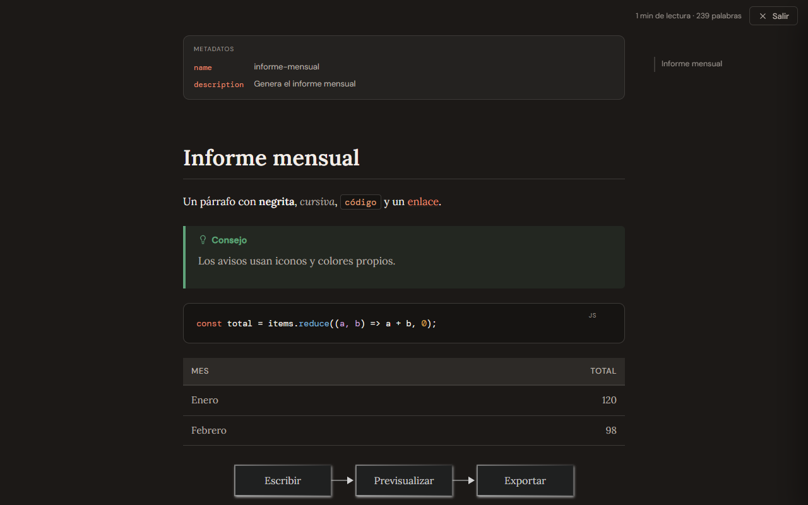

<div align="center">

# MD Studio

**Lector y editor de Markdown que funciona en el navegador y se instala como aplicación (PWA).**
Sin servidor: todo ocurre en tu equipo.

[**Abrir la app**](https://luckstudio.github.io/MD-Studio/) · [Ver el vídeo](https://luckstudio.github.io/MD-Studio/media/MD-Studio-tutorial.mp4) · [Qué hace](#qué-hace) · [Instalar](#instalar-y-abrir-los-md-con-la-app)

<a href="https://luckstudio.github.io/MD-Studio/media/MD-Studio-tutorial.mp4">
  
</a>

<sub>▶ Vídeo promocional · 1:22 · también en el repositorio: <a href="media/MD-Studio-tutorial.mp4"><code>media/MD-Studio-tutorial.mp4</code></a></sub>

</div>

## Capturas

<table>
  <tr>
    <td width="50%"><br><sub><b>Vista dividida</b> · editor y vista previa editable (oscuro)</sub></td>
    <td width="50%"><br><sub><b>Tema claro</b> · front matter, avisos, código, tablas, Mermaid y fórmulas</sub></td>
  </tr>
  <tr>
    <td><br><sub><b>Inicio</b> · abrir archivo o carpeta, recientes y plantillas</sub></td>
    <td><br><sub><b>Paleta de comandos</b> (<kbd>Ctrl</kbd>+<kbd>K</kbd>) · comandos, archivos, títulos y pestañas</sub></td>
  </tr>
  <tr>
    <td><br><sub><b>Exportar</b> · PDF, HTML, Word (.docx), texto y enlace para compartir</sub></td>
    <td><br><sub><b>Modo lectura</b> · progreso, índice lateral y tiempo de lectura</sub></td>
  </tr>
</table>

| Forma | Cómo | Para qué |
|---|---|---|
| **Web instalable (PWA)** | [luckstudio.github.io/MD-Studio](https://luckstudio.github.io/MD-Studio/) (o `npm run serve`) e instalar desde Chrome/Edge | Abrir `.md` desde el sistema, offline, en cualquier dispositivo |
| **Un solo archivo** | `npm run build` → `dist/claude-md-editor.html` | Doble clic, sin instalar nada (USB, correo) |

## Qué hace

**Editar**
- **Como un documento de texto**: la vista previa se escribe directamente, **en cualquier vista** (dividida o solo previsualización; en el editor de código se ve el Markdown). Solo se reescribe el bloque tocado; el resto del archivo queda idéntico. En edición, un clic coloca el cursor y `Ctrl+clic` abre el enlace.
- **Barra lateral y botón «+»** también sobre la vista previa: aplican títulos, negrita, listas, tablas… donde esté el cursor, con el mismo resultado que en el editor de código.
- **Clic derecho con paneles propios** en todo (vista previa, editor, pestañas, carpeta, índice, recientes y resto de la app): duplicar, subir/bajar, **convertir en** título/cita/lista/tarea, insertar debajo, copiar el Markdown del bloque, acciones de tabla (fila/columna/alinear)… Con `Mayús+clic derecho` vuelve el menú del navegador.
- Barra flotante de formato, atajos Markdown (`# `, `- `, `1. `, `> `), Ctrl+K para enlaces, pegado de Markdown, Ctrl+Z/Y.
- **Menú `/`** para insertar bloques (títulos, listas, tareas, cita, código, tabla, aviso, imagen, Mermaid, fórmula).
- **Editor de tablas** (filas, columnas, alineación, Tab entre celdas) y **editor de código fuente** con vista previa en directo para Mermaid, fórmulas y HTML.
- **Imágenes**: pegar, soltar o elegir → se guardan en `assets/` junto al documento y se enlazan con ruta relativa.

**Leer**
- Resaltado de código (+ copiar), **Mermaid**, **KaTeX**, avisos `> [!NOTE]`, ficha de metadatos del front matter, índice y **modo lectura** (progreso, índice lateral, tiempo de lectura).

**Carpetas y enlaces**
- Abrir una carpeta: árbol, búsqueda por nombre y en contenido, imágenes y enlaces relativos.
- **`[[wikilinks]]`** (con creación si no existen) y panel de **enlaces entrantes**.
- **Paleta de comandos** (Ctrl+K): comandos, archivos (`@`), títulos (`#`), línea (`:`), pestañas y recientes, con búsqueda difusa.

**No pierdas nada**
- Autoguardado, cada pestaña recuerda su archivo, aviso si el archivo cambia en disco, vista de diferencias y **historial de versiones** por archivo (restaurar con deshacer).

**Exportar** (menú Archivo → Exportar…)
- PDF (papel, márgenes, tipografía, numeración), HTML autónomo, **Word (.docx)** con numeración y estilos reales, texto, Markdown y **enlace para compartir** (el documento va comprimido dentro del enlace; no se sube a ningún servidor).

**Archivos de Claude**
- Reconoce `SKILL.md`, `CLAUDE.md`, `agents/*.md` y `commands/*.md`: valida el front matter, avisa si pesan demasiado y desglosa los tokens por sección. Plantillas para crearlos.

**Aprender y primera impresión**
- **Tutorial animado** (tipo vídeo, ≈ 1:20): 11 escenas con cursor, menús y escritura simulados que recorren todo el flujo (abrir, vistas, escribir y `/`, barra lateral, clic derecho, tablas, carpetas y Ctrl+K, guardado e historial, exportar). Cámara que se acerca a la acción, tarjetas de capítulo y transición con barrido entre escenas, subtítulos palabra a palabra, **música y efectos de sonido generados en el momento** (Web Audio, sin archivos; la intensidad de la música sube con las escenas) con botón/tecla `M` para silenciar. Pausa, velocidad, saltos por escena y barra de posición; se abre desde el Inicio, Archivo → Tutorial animado o la paleta. Con «reducir movimiento» no se reproduce solo.
- **Pantalla de carga**: solo el icono y una barra de progreso, con fundido al terminar. Se puede desactivar en Apariencia.
- **Fundidos entre pantallas**: el inicio, los diálogos, la paleta, los menús y el cambio de vista se funden al abrir y al cerrar.
- Recorrido guiado de 4 pasos sobre la propia interfaz.

**Seguridad**: el HTML del Markdown se sanea con DOMPurify (sobre un documento inerte), la CSP prohíbe scripts en línea y las acciones del marcado pasan por una lista cerrada.

**Cómo abrirla**: doble clic en `Iniciar.cmd` (arranca el servidor local y abre el navegador) o `npm run serve`. Abrir `app/index.html` con doble clic NO funciona en Chrome/Edge (bloquean los módulos en `file://`; la app avisa); para doble clic usa `dist/claude-md-editor.html`.

## Calidad medida

| | |
|---|---|
| Lighthouse (accesibilidad · buenas prácticas · SEO) | 100 · 100 · 100 |
| Accesibilidad | WCAG 2.1 AA verificada con axe en 14 pantallas × 2 temas; foco, teclado y diálogos modales |
| LCP / CLS (bundle de producción, local) | 361 ms / 0,00 |
| Repintado al teclear en un documento de 300 KB (6000 bloques) | ≈ 110 ms (antes ≈ 630 ms) |
| Tests | 131 (Playwright): app, tutorial, pantalla de carga, menús contextuales, edición en cualquier vista, edición, bloques, tablas, imágenes, paleta, historial, wikilinks, exportación, rendimiento, movimiento, accesibilidad, capturas visuales, bundle y versión de un solo archivo |

## Estructura

```
app/                      ← la aplicación (código fuente)
  index.html              marcado, CSP, iconos SVG (sprite), entrada del módulo
  src/                    módulos ES (un archivo por tema); main.js es el punto de entrada
    state.js              estado compartido: constantes del DOM y el objeto S (lo que varios módulos reasignan)
    events.ts             bus de eventos tipado (doc:rendered, doc:saved, view:changed…)
    preview-edit.js       edición de la vista previa en cualquier vista; enruta barra lateral, «+» y atajos
    ctxmenu.js · contextmenus.js · blockops.js   menú contextual (componente), sus proveedores por zona y operaciones sobre bloques
    splash.js             pantalla de carga (icono + barra)
    tutorial.js · tutorial-audio.js   tutorial animado (escenas con guion temporizado, reloj propio, cámara) y su música/efectos sintetizados
    frontmatter.ts · diff-core.ts   núcleo puro y tipado (TypeScript)
  css/                    tokens.css (diseño) · motion.css (movimiento) · tutorial.css · el resto por zonas
  vendor/ fonts/ icons/   librerías, tipografías locales y iconos (versionados)
  manifest.webmanifest · sw.js   PWA: instalación, asociación con .md, «Compartir» (Android), offline
tools/
  build.mjs               esbuild → dist/web (bundle minificado) + dist/claude-md-editor.html + sw-manifest
  serve.mjs               servidor de desarrollo sin caché (transpila .ts al vuelo); --prod sirve dist/web
  vendor.mjs              copia librerías de node_modules a app/vendor, fuentes, sprite de iconos y CSS de avisos
tests/                    Playwright (ver arriba) · capturas en tests/visual.spec.mjs-snapshots
legacy/                   versiones antiguas de un solo archivo (ya están en el historial de git)
```

## Comandos

```bash
npm install        # una vez
npm run serve      # http://localhost:8765 — módulos sin empaquetar, sin caché
npm run serve:prod # http://localhost:8765 — el bundle de dist/web
npm test           # build + Playwright (usa el Edge instalado; PW_CHANNEL=chrome para Chrome)
npm run typecheck  # tsc sobre los módulos .ts
npm run build      # dist/web + dist/claude-md-editor.html + sw-manifest.js
npm run vendor     # tras actualizar dependencias: recopia vendor, fuentes, iconos…
```

Ideas y plan de desarrollo: [PROPUESTAS.md](PROPUESTAS.md).

Las capturas del README se regeneran con `npm run screenshots` (`docs/screenshots/`).

Si un cambio de diseño es intencionado, regenera las capturas de los tests: `npx playwright test tests/visual.spec.mjs --update-snapshots`.

## Cómo está hecho (decisiones que no se ven en el código)

- **Módulos ES + estado `S`**: un `import` de ES es de solo lectura, así que lo que varios módulos reasignan (pestañas, pestaña activa, vista, …) vive en el objeto `S` de `state.js`. Lo que solo reasigna su propio módulo se exporta como `let` (enlace vivo).
- **Eventos en vez de llamadas cruzadas**: `render.js` anuncia `doc:rendered`; `claude.js`, `wikilinks.js` y `workspace.js` se suscriben. Lo mismo con `doc:saved` y `view:changed`.
- **Edición fiel**: `parseMarkdownBlocks()` da a cada bloque su posición `[s,e)` en el texto; al editar un bloque solo se convierte ese bloque de HTML a Markdown (turndown) y se sustituye su trozo. Los bloques que no se pueden reconstruir con garantías son de solo lectura.
- **Pintado incremental**: caché por bloque (mismo texto ⇒ mismo HTML) y `patchPreview()` reutiliza los nodos que no cambian (conservan diagramas y fórmulas ya dibujados).
- **Pruebas sobre módulos**: `tests/_setup.mjs` activa `window.__EXPOSE_APP__`; `main.js` expone entonces cada exportación como global (con enlace vivo) para poder llamar a la app desde `page.evaluate`.
- **TypeScript gradual**: `.ts` solo en los módulos puros (`events`, `frontmatter`, `diff-core`); el resto es JavaScript. `npm run typecheck` los comprueba.

## Instalar y abrir los .md con la app

1. Publicar `dist/web` por HTTPS (hay un workflow para GitHub Pages en `.github/workflows/pages.yml`) o, solo para probar, `npm run serve`.
2. Abrirla en Chrome o Edge y pulsar **Instalar como aplicación**. Instalada desde `localhost` también funciona sin servidor: el service worker la sirve desde la caché.
3. Windows: clic derecho en un `.md` → *Abrir con* → *Elegir otra aplicación* → *MD Studio* → *Usar siempre*.

| Plataforma | PWA instalable | Abrir .md desde el sistema | Compartir hacia la app |
|---|---|---|---|
| Windows / macOS / Linux (Chrome, Edge) | Sí | Sí | – |
| Android (Chrome) | Sí | No | Sí |
| iOS / iPadOS (Safari) | Sí (Compartir → Añadir a inicio) | No | No |
| Firefox | No | No | No |

## Límites conocidos

- Documentos de más de ~10 000 bloques tardan en el primer pintado (≈ 1 s por cada 6000); después el repintado es incremental.
- Retroceso/Supr unen párrafos y títulos entre sí; en listas, código y tablas se edita dentro del propio bloque.
- El primer abrir una carpeta pide permiso de escritura (necesario para `assets/` y crear `[[enlaces]]`); en Firefox/Safari la API de archivos no existe y se usa importar/descargar.
- Los avisos de consola `Executing inline event handler violates…` al abrir un Markdown con `onerror=` son ruido del analizador: el atributo se elimina y nunca se ejecuta.
